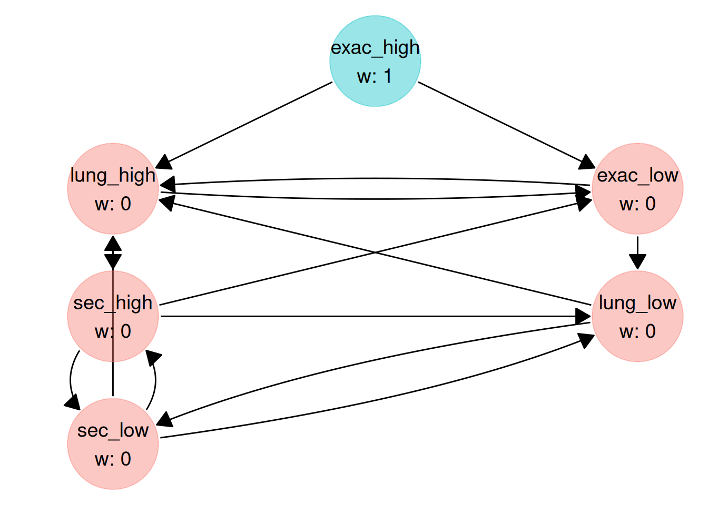
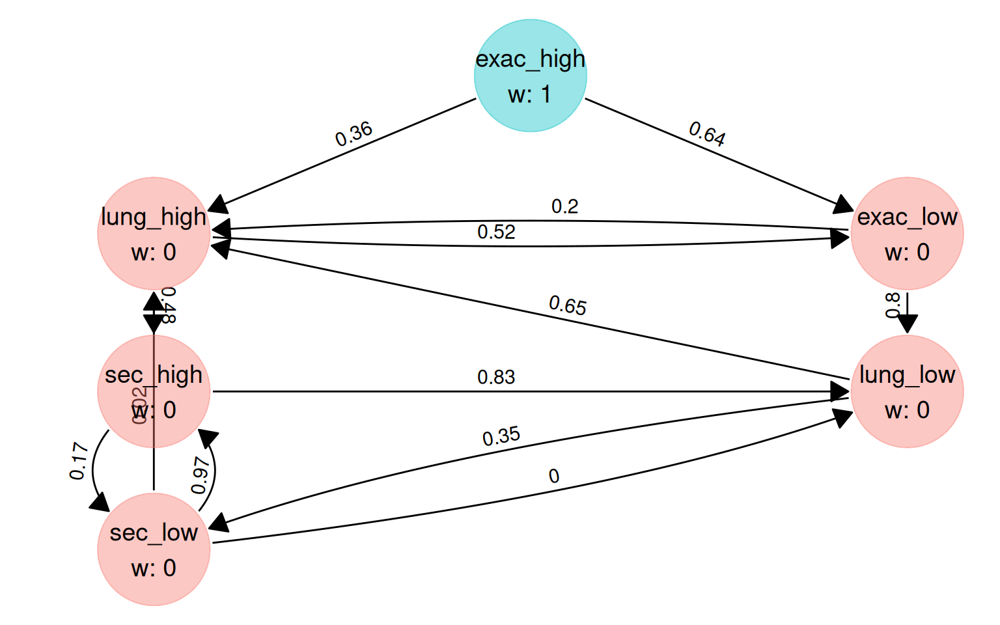

# Families of hypotheses

## Why families?

Multiplicity strategies are often drawn as boxes of hypotheses rather
than single hypotheses. Each box, a *family*, is tested with a multiple
test procedure such as Hommel’s or Hochberg’s, and the boxes are
connected by a graph. Maurer and Bretz (2014) show how to run such a
design as a graphical procedure:

- the hypotheses in a family are tested at the family’s local
  significance level, with a procedure such as Hommel’s, Hochberg’s or
  Holm’s;
- a family passes its significance level on along the graph only when
  **every** hypothesis in it is rejected.

The procedure strongly controls the family-wise error rate, provided the
procedure used within each family controls its own error rate at the
family’s level (see [Things to know](#things-to-know)).

[`graph_optimise()`](https://gsk-biostatistics.github.io/multigrain/dev/reference/graph_optimisation.md)
can optimise such a graph. The nodes of the graph are the families, so
the weights and the transition matrix it optimises are those between
families. You describe the families with
[`family_spec()`](https://gsk-biostatistics.github.io/multigrain/dev/reference/family_spec.md)
and pass the result as the `families` argument.

## A two-dose trial

The ETHOS trial (Rabe et al., 2020) compared triple inhaled therapy at
two glucocorticoid doses with two dual therapies in COPD. Its testing
strategy groups the comparisons into boxes, with the secondary endpoints
of each comparison tested with Hochberg’s procedure. We use a
**simplified version** of that strategy with **illustrative**
assumptions, not the trial’s.

Two doses of triple therapy (high and low) are each compared with two
dual therapies, A and B. For each dose there are three families:

| Family                                                | High dose | Low dose | Within-family test |
|-------------------------------------------------------|-----------|----------|--------------------|
| Exacerbations: rate vs A, rate vs B                   | H1, H2    | H7, H8   | Hommel             |
| Lung function: FEV1 AUC vs B, trough FEV1 vs A        | H3, H4    | H9, H10  | Hommel             |
| Secondary: time to first exacerbation vs A, SGRQ vs A | H5, H6    | H11, H12 | Hochberg           |

As in ETHOS, all of $\alpha$ starts on the high-dose exacerbation
family, which passes it on to the low-dose exacerbation family and to
the high-dose lung function family.

### P-values

`pvals` has one column per hypothesis, as usual. Comparisons that share
an arm have correlated test statistics (0.5 with equal allocation), and
so do related endpoints.

``` r
# Each hypothesis compares one dose with one dual therapy on one endpoint
comparison <- c(
    "high_vs_A", "high_vs_B", "high_vs_B", "high_vs_A", "high_vs_A", "high_vs_A",
    "low_vs_A", "low_vs_B", "low_vs_B", "low_vs_A", "low_vs_A", "low_vs_A"
)
endpoint <- rep(
    c("exac", "exac", "fev1_auc", "fev1_trough", "time_exac", "sgrq"),
    times = 2
)

# Comparisons that share an arm (equal allocation) have correlation 0.5
corr_comparison <- matrix(
    c(
        1, 0.5, 0.5, 0,
        0.5, 1, 0, 0.5,
        0.5, 0, 1, 0.5,
        0, 0.5, 0.5, 1
    ),
    nrow = 4,
    dimnames = rep(list(c("high_vs_A", "high_vs_B", "low_vs_A", "low_vs_B")), 2)
)

# Endpoints: 0.6 between the two exacerbation endpoints, 0.7 between the two
# lung function endpoints, 0.2 otherwise
endpoints <- c("exac", "time_exac", "fev1_auc", "fev1_trough", "sgrq")
corr_endpoint <- matrix(0.2, 5, 5, dimnames = list(endpoints, endpoints))
diag(corr_endpoint) <- 1
corr_endpoint["exac", "time_exac"] <- 0.6
corr_endpoint["time_exac", "exac"] <- 0.6
corr_endpoint["fev1_auc", "fev1_trough"] <- 0.7
corr_endpoint["fev1_trough", "fev1_auc"] <- 0.7

corr_matrix <- corr_comparison[comparison, comparison] *
    corr_endpoint[endpoint, endpoint]
dimnames(corr_matrix) <- NULL

set.seed(2020)
pvals <- simulate_pvalues(
    power_nominal = c(
        0.85, 0.75, 0.95, 0.80, 0.70, 0.60, # high dose
        0.80, 0.70, 0.95, 0.80, 0.65, 0.55 # low dose
    ),
    corr_matrix = corr_matrix,
    nsim = 1e5
)
```

### Families

[`family_spec()`](https://gsk-biostatistics.github.io/multigrain/dev/reference/family_spec.md)
lists the hypotheses (columns of `pvals`) in each family and the test
used within each family. The names become the names of the graph’s
nodes.

``` r
fams <- family_spec(
    list(
        exac_high = 1:2,
        lung_high = 3:4,
        sec_high = 5:6,
        exac_low = 7:8,
        lung_low = 9:10,
        sec_low = 11:12
    ),
    test = c("hommel", "hommel", "hochberg", "hommel", "hommel", "hochberg")
)

fams
#> <multigrain_family_spec>
#> Hypotheses (columns of the p-value matrix) in each family:
#> exac_high (hommel): 1 2
#> lung_high (hommel): 3 4
#> sec_high  (hochberg): 5 6
#> exac_low  (hommel): 7 8
#> lung_low  (hommel): 9 10
#> sec_low   (hochberg): 11 12
```

### Trial success

The trial success measure is written in terms of the **individual
hypotheses**, exactly as without families: `r1` is the rejection of H1,
and so on. The success of a whole family is a conjunction, for example
`r1 && r2`. Here, rejecting both exacerbation comparisons is worth 4 for
the high dose and 2 for the low dose, each lung function comparison is
worth 1 and each secondary comparison 0.5.

``` r
gain <- trial_success(
    4 * (r1 && r2) + 2 * (r7 && r8) +
        r3 + r4 + r9 + r10 +
        0.5 * (r5 + r6 + r11 + r12)
)
#> ✔ Trial success function compiled and sourced successfully.
```

### The hierarchy as drawn

A graph with families has one node per family, so its weights and
transition matrix are $6 \times 1$ and $6 \times 6$. The hierarchy below
splits the high-dose exacerbation family’s $\alpha$ equally between its
two successors, and lets each secondary family pass its $\alpha$ to the
other dose’s secondary family.

``` r
fam_names <- names(fams$members)

hyp_weight_drawn <- c(1, 0, 0, 0, 0, 0)
trans_matrix_drawn <- matrix(
    c(
        0, 0.5, 0, 0.5, 0, 0, # exac_high -> lung_high, exac_low
        0, 0, 1, 0, 0, 0, # lung_high -> sec_high
        0, 0, 0, 0, 0, 1, # sec_high  -> sec_low
        0, 0, 0, 0, 1, 0, # exac_low  -> lung_low
        0, 0, 0, 0, 0, 1, # lung_low  -> sec_low
        0, 0, 1, 0, 0, 0 # sec_low   -> sec_high
    ),
    nrow = 6,
    byrow = TRUE,
    dimnames = list(fam_names, fam_names)
)

power_drawn <- calc_power_pvals(
    pvals,
    hyp_weight = hyp_weight_drawn,
    trans_matrix = trans_matrix_drawn,
    custom_power = list(gain = gain),
    families = fams
)

power_drawn$family_power
#> exac_high lung_high  sec_high  exac_low  lung_low   sec_low 
#>   0.68068   0.47893   0.22224   0.39630   0.28505   0.16020
power_drawn$gain
#> [1] 5.82886
```

With `families`,
[`calc_power_pvals()`](https://gsk-biostatistics.github.io/multigrain/dev/reference/calc_power_pvals.md)
also returns `family_power`: the probability that every hypothesis in a
family is rejected, which is when the family passes its $\alpha$ on.
`local_power` still has one entry per hypothesis.

## Optimising the family graph

The graph constraint has one node per family. We keep all initial weight
on the high-dose exacerbation family and allow a few edges beyond the
drawn ones (`NA` marks an edge to optimise). Nothing points back to the
high-dose exacerbation family: it holds all of $\alpha$ at the start, so
it is always the first family to be emptied.

``` r
fam_constraint <- graph_constraint(
    hyp_constraint = c(1, 0, 0, 0, 0, 0),
    trans_constraint = matrix(
        c(
            0, NA, 0, NA, 0, 0, # exac_high -> lung_high, exac_low
            0, 0, NA, NA, 0, 0, # lung_high -> sec_high, exac_low
            0, 0, 0, NA, NA, NA, # sec_high  -> low-dose families
            0, NA, 0, 0, NA, 0, # exac_low  -> lung_high, lung_low
            0, NA, 0, 0, 0, NA, # lung_low  -> lung_high, sec_low
            0, NA, NA, 0, NA, 0 # sec_low   -> lung_high, sec_high, lung_low
        ),
        nrow = 6,
        byrow = TRUE
    ),
    names = fam_names
)

plot(fam_constraint)
```



The call to
[`graph_optimise()`](https://gsk-biostatistics.github.io/multigrain/dev/reference/graph_optimisation.md)
is the usual one, plus `families`. `pvals` and `gain` refer to the 12
hypotheses; `fam_constraint` refers to the 6 families.

``` r
set.seed(1)
graph_fam <- graph_optimise(
    pvals = pvals,
    graph_constraint = fam_constraint,
    trial_success = gain,
    families = fams,
    num_threads = 4
)
```

``` r
graph_fam
#> <multigrain_graph_optimal>
#> Optimal graph found (given user-defined constraints on graph and computational resources):
#> 
#> Hypothesis weights:
#> exac_high lung_high  sec_high  exac_low  lung_low   sec_low 
#>         1         0         0         0         0         0 
#> 
#> Transition matrix:
#>           exac_high lung_high sec_high exac_low lung_low sec_low
#> exac_high         0    0.3627   0.0000   0.6373   0.0000  0.0000
#> lung_high         0    0.0000   0.4845   0.5155   0.0000  0.0000
#> sec_high          0    0.0000   0.0000   0.0000   0.8333  0.1667
#> exac_low          0    0.1956   0.0000   0.0000   0.8044  0.0000
#> lung_low          0    0.6494   0.0000   0.0000   0.0000  0.3506
#> sec_low           0    0.0234   0.9732   0.0000   0.0034  0.0000
#> 
#> Families of hypotheses (one per node):
#> exac_high (hommel): 1 2
#> lung_high (hommel): 3 4
#> sec_high  (hochberg): 5 6
#> exac_low  (hommel): 7 8
#> lung_low  (hommel): 9 10
#> sec_low   (hochberg): 11 12
#> 
#> Trial success function:
#> 4 * (r1 && r2) + 2 * (r7 && r8) + r3 + r4 + r9 + r10 + 0.5 * (r5 + r6 + r11 + r12)
#> 
#> Value of trial success measure:
#> 6.0397
```

``` r
plot(graph_fam)
```



### Comparing the two graphs

The optimised graph was chosen on `pvals`, so its gain on those p-values
is optimistic. We compare both graphs on an independent sample.

``` r
set.seed(2021)
pvals_new <- simulate_pvalues(
    power_nominal = c(
        0.85, 0.75, 0.95, 0.80, 0.70, 0.60,
        0.80, 0.70, 0.95, 0.80, 0.65, 0.55
    ),
    corr_matrix = corr_matrix,
    nsim = 1e5
)

compare_graphs <- function(hyp_weight, trans_matrix) {
    power <- calc_power_pvals(
        pvals_new,
        hyp_weight = hyp_weight,
        trans_matrix = trans_matrix,
        custom_power = list(gain = gain),
        families = fams
    )
    c(gain = power$gain, power$family_power)
}

rbind(
    drawn = compare_graphs(hyp_weight_drawn, trans_matrix_drawn),
    optimised = compare_graphs(graph_fam$hyp_weight, graph_fam$trans_matrix)
) |>
    knitr::kable(digits = 3)
```

|           |  gain | exac_high | lung_high | sec_high | exac_low | lung_low | sec_low |
|:----------|------:|----------:|----------:|---------:|---------:|---------:|--------:|
| drawn     | 5.874 |     0.683 |     0.482 |    0.224 |    0.401 |    0.290 |   0.164 |
| optimised | 6.077 |     0.683 |     0.488 |    0.198 |    0.451 |    0.362 |   0.139 |

The columns after `gain` are the probabilities that each family is
emptied, i.e. passes its $\alpha$ on.

## Things to know

- **Dependence within families.** Hommel’s and Hochberg’s procedures
  control the error rate when the test statistics within a family are
  positively dependent, for example one-sided tests based on
  multivariate normal statistics with non-negative correlations, as
  here. This cannot be checked from `pvals`. Use `test = "holm"` for a
  family where negative dependence is possible.
- **All or nothing.** A family passes its $\alpha$ on only when all of
  its hypotheses are rejected, so its least powerful hypothesis decides.
  A large family with one weak hypothesis rarely passes anything on;
  splitting it into smaller families is a design option that
  [`graph_optimise()`](https://gsk-biostatistics.github.io/multigrain/dev/reference/graph_optimisation.md)
  can evaluate.
- **Two kinds of index.** `pvals`,
  [`trial_success()`](https://gsk-biostatistics.github.io/multigrain/dev/reference/trial_success.md)
  and `local_power` refer to the individual hypotheses.
  [`graph_constraint()`](https://gsk-biostatistics.github.io/multigrain/dev/reference/graph_constraint.md),
  `start_graph`, the optimised weights and transition matrix, and
  `family_power` refer to the families.
- **What is optimised.** Families are combined with a weighted
  Bonferroni test, and only the weights and transitions between families
  are optimised. The tests within families are fixed.

## References

Hochberg, Y. (1988). A sharper Bonferroni procedure for multiple tests
of significance. *Biometrika*, 75(4), 800–802.

Hommel, G. (1988). A stagewise rejective multiple test procedure based
on a modified Bonferroni test. *Biometrika*, 75(2), 383–386.

Maurer, W. and Bretz, F. (2014). A note on testing families of
hypotheses using graphical procedures. *Statistics in Medicine*, 33(30),
5340–5346.

Rabe, K. F., Martinez, F. J., Ferguson, G. T., et al. (2020). Triple
inhaled therapy at two glucocorticoid doses in moderate-to-very-severe
COPD. *New England Journal of Medicine*, 383(1), 35–48.
<https://doi.org/10.1056/NEJMoa1916046>
