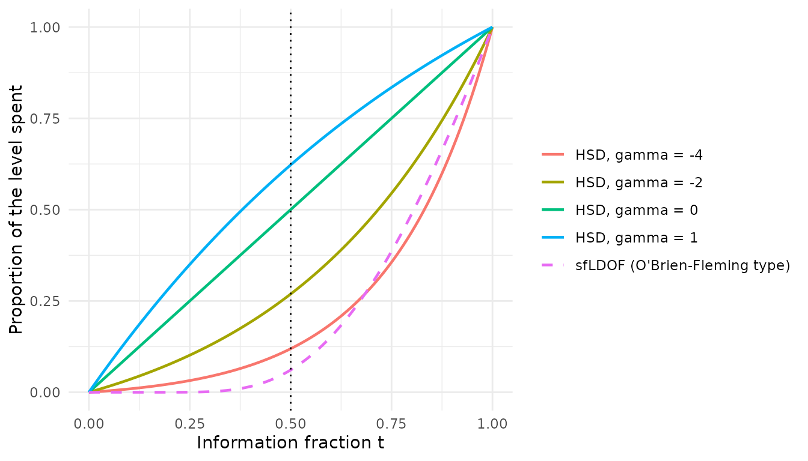
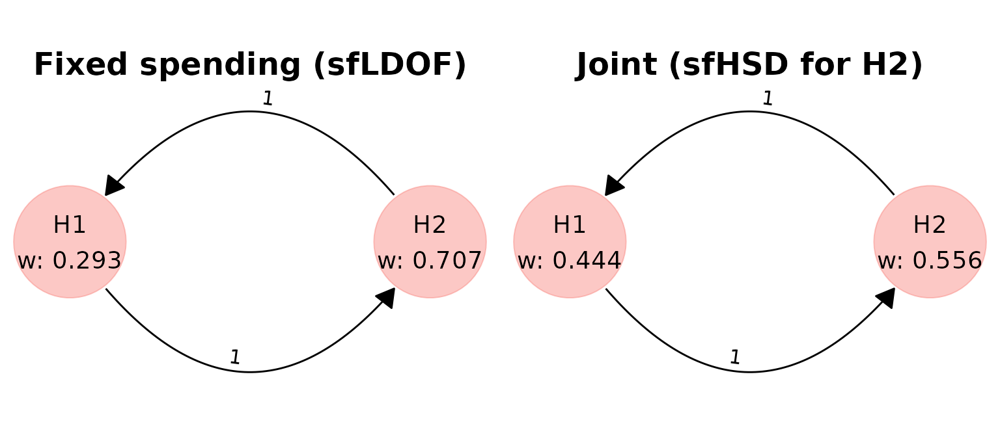
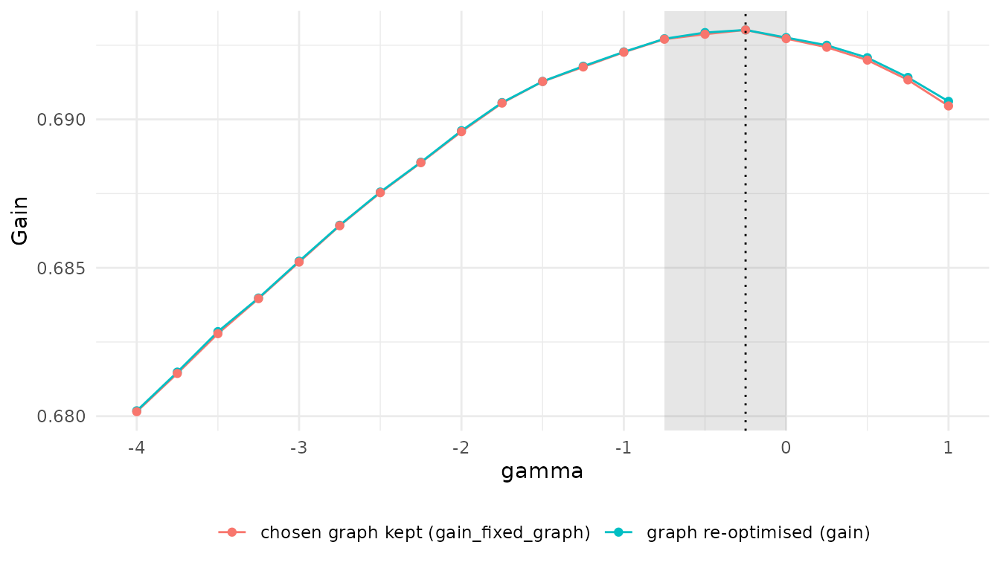
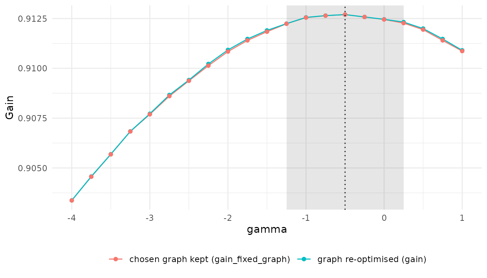

# Choosing the spending function and the graph together

## What this article covers

A group sequential design (GSD) looks at the data more than once. Each
hypothesis then needs a *spending function*, which decides how much of
its significance level may be used at each look. Spending functions are
usually picked from a short list before the graph is optimised. This
article shows how **`multigrain`** can choose one spending parameter
*together with* the graph, and how to read the result.

It builds on two other articles, which it does not repeat:

- [Getting
  started](https://gsk-biostatistics.github.io/multigrain/dev/articles/get-started.md)
  explains graphical multiple testing procedures (hypothesis weights
  $\mathbf{w}$ and transition matrix $\mathbf{G}$), gain functions and
  [`graph_optimise()`](https://gsk-biostatistics.github.io/multigrain/dev/reference/graph_optimisation.md).
- [Trial success
  measures](https://gsk-biostatistics.github.io/multigrain/dev/articles/trial_success.md)
  explains the group sequential workflow with *fixed* spending
  functions:
  [`simulate_pvalues_gsd()`](https://gsk-biostatistics.github.io/multigrain/dev/reference/simulate_pvalues_gsd.md),
  [`transform_pvalues_gsd()`](https://gsk-biostatistics.github.io/multigrain/dev/reference/transform_pvalues_gsd.md),
  gains that depend on when a hypothesis is rejected
  ([`trial_success_gsd()`](https://gsk-biostatistics.github.io/multigrain/dev/reference/trial_success_gsd.md)
  and its discount tables), stopping rules
  ([`stopping_rule_gsd()`](https://gsk-biostatistics.github.io/multigrain/dev/reference/stopping_rule_gsd.md))
  and
  [`graph_optimise_gsd()`](https://gsk-biostatistics.github.io/multigrain/dev/reference/graph_optimise_gsd.md).

The optimisation framework is described in [Spiers et al. (2026),
*Gain-function optimisation of graphical multiple testing procedures for
confirmatory clinical trials*
(arXiv:2609.19994v1)](https://arxiv.org/abs/2609.19994). The second
example below extends its Example 5.

## A short primer on interim analyses and spending

**Interim analyses.** In a GSD the data are analysed at planned *looks*,
for example once when half the patients have their outcome and once at
the end. The amount of data at a look is its *information fraction* $t$:
$t = 0.5$ at the halfway look and $t = 1$ at the final one. If a
hypothesis is rejected at an interim look, the trial can stop early for
efficacy.

**Spending functions.** Testing the same hypothesis at full level
$\alpha$ at every look would inflate the type I error. Instead, each
hypothesis gets an *α-spending function* $\alpha(t)$: the cumulative
part of its level that may be used by information fraction $t$, rising
to the whole level at $t = 1$. The boundary at each look is set so that
the probability of crossing any boundary by that look, under the null
hypothesis, equals $\alpha(t)$. A spending function that spends little
early keeps almost the full level for the final analysis; one that
spends a lot early makes early rejection more likely but leaves a
stricter final boundary.

**The Hwang–Shih–DeCani family.** The HSD spending functions
([`gsDesign::sfHSD()`](https://keaven.github.io/gsDesign//reference/sfHSD.html))
have one parameter $\gamma$:

$$\alpha(t) = \alpha\,\frac{1 - e^{- \gamma t}}{1 - e^{- \gamma}},\qquad\gamma \neq 0,$$

and $\alpha(t) = \alpha t$ for $\gamma = 0$. Some texts write the
parameter as $\theta$. Negative values spend little early: at $t = 0.5$,
$\gamma = - 4$ has spent about 12% of the level, close to
O’Brien–Fleming spending. $\gamma = 0$ spends in proportion to
information, and $\gamma = 1$ has spent about 62% at $t = 0.5$, close to
Pocock spending. So one number moves the design smoothly between the two
textbook choices.

``` r
alpha <- 0.025
t <- seq(0, 1, by = 0.01)
gammas <- c(-4, -2, 0, 1)

spent <- do.call(rbind, lapply(gammas, function(g) {
    data.frame(
        t = t,
        spent = gsDesign::sfHSD(alpha, t, g)$spend / alpha,
        curve = sprintf("HSD, gamma = %g", g)
    )
}))
spent <- rbind(
    spent,
    data.frame(
        t = t,
        spent = gsDesign::sfLDOF(alpha, t)$spend / alpha,
        curve = "sfLDOF (O'Brien-Fleming type)"
    )
)
spent$curve <- factor(spent$curve, levels = unique(spent$curve))

ggplot(spent, aes(t, spent, colour = curve, linetype = curve)) +
    geom_line(linewidth = 0.8) +
    geom_vline(xintercept = 0.5, linetype = "dotted") +
    scale_linetype_manual(values = c(rep("solid", 4), "dashed")) +
    labs(
        x = "Information fraction t",
        y = "Proportion of the level spent",
        colour = NULL,
        linetype = NULL
    ) +
    theme_minimal()
```



The dotted line marks the interim look used below. The dashed curve,
[`gsDesign::sfLDOF`](https://keaven.github.io/gsDesign//reference/sfLDOF.html),
is the Lan–DeMets O’Brien–Fleming-type function used for the primary
hypothesis throughout.

## Why spending and graph should be chosen together

Take two hypotheses: a primary $H_{1}$ and a key secondary $H_{2}$, each
tested at an interim look ($t = 0.5$) and a final look ($t = 1$), at
one-sided $\alpha = 0.025$. The nominal powers are 0.90 and 0.80 and the
test statistics are correlated with $\rho = 0.5$. $H_{1}$ uses
[`gsDesign::sfLDOF`](https://keaven.github.io/gsDesign//reference/sfLDOF.html).

The gain values $H_{1}$ at 0.6 and $H_{2}$ at 0.4. A claim at the final
analysis is worth 0.8 of the same claim at the interim (the discount
table `d`), and the trial **stops as soon as $H_{1}$ is rejected**:

``` r
gain <- trial_success_gsd(0.6 * d(t1) + 0.4 * d(t2), d = c(1, 0.8))
rule <- stopping_rule_gsd(r1)
```

Here `t1` and `t2` are the looks at which $H_{1}$ and $H_{2}$ were
rejected (0 if never), and `r1` is “$H_{1}$ has been rejected”; see
[Trial success
measures](https://gsk-biostatistics.github.io/multigrain/dev/articles/trial_success.md)
for the syntax.

The stopping rule is what ties the spending of $H_{2}$ to the graph. If
$H_{1}$ is rejected at the interim, the trial stops there, so $H_{2}$
gets its interim look and nothing else. Whether $H_{2}$ is rejected in
that trial then depends on two things:

1.  **How much level the graph gives $H_{2}$**: its own weight $w_{2}$,
    plus what $H_{1}$ passes on once it is rejected.
2.  **How much of that level $H_{2}$’s spending function lets it use at
    $t = 0.5$.** Under O’Brien–Fleming-type spending it is very little.

The graph also decides how often the trial stops: a larger $w_{1}$ makes
an interim rejection of $H_{1}$, and therefore a stop, more likely. With
O’Brien–Fleming-type spending on $H_{2}$ a stop is costly, so the best
graph keeps $w_{1}$ low. With spending that uses more of the level
early, a stop costs less and the best graph can put more weight on
$H_{1}$. The best graph depends on the spending function, and the best
spending function depends on the graph, so the two should be chosen
together.

## Simulate the p-values once

[`simulate_pvalues_gsd()`](https://gsk-biostatistics.github.io/multigrain/dev/reference/simulate_pvalues_gsd.md)
draws raw p-values at every look; the information fractions are stored
with them.

``` r
set.seed(20261007)
raw <- simulate_pvalues_gsd(
    power_nominal = c(H1 = 0.90, H2 = 0.80),
    corr_matrix = matrix(c(1, 0.5, 0.5, 1), nrow = 2),
    info_frac = c(0.5, 1),
    nsim = 1e5
)
```

Both runs below use these same draws, so their gains can be compared
directly.

## Baseline: fixed spending

First, the usual approach: fix the spending of both hypotheses at
[`gsDesign::sfLDOF`](https://keaven.github.io/gsDesign//reference/sfLDOF.html)
and optimise the graph alone.

``` r
pv_ldof <- transform_pvalues_gsd(raw, spending = gsDesign::sfLDOF)

main_base <- graph_optimise_gsd(
    pv_ldof,
    graph_constraint_free(2),
    gain,
    stopping_rule = rule
)
main_base
```

    #> <multigrain_graph_optimal>
    #> Optimal graph found (given user-defined constraints on graph and computational resources):
    #> 
    #> Hypothesis weights:
    #>     H1     H2 
    #> 0.2927 0.7073 
    #> 
    #> Transition matrix:
    #>    H1 H2
    #> H1  0  1
    #> H2  1  0
    #> 
    #> Trial success function:
    #> 0.6 * d(t1) + 0.4 * d(t2)
    #> 
    #> Stopping rule:
    #> Every interim: r1
    #> Hypotheses referenced: up to r1
    #> 
    #> Value of trial success measure:
    #> 0.6709

## Joint optimisation

To let the spending of $H_{2}$ be chosen, tag it with
[`sf_hsd_opt()`](https://gsk-biostatistics.github.io/multigrain/dev/reference/sf_hsd_opt.md)
in the list of spending functions.
[`transform_pvalues_gsd()`](https://gsk-biostatistics.github.io/multigrain/dev/reference/transform_pvalues_gsd.md)
then returns a *spending spec* instead of transformed p-values:

``` r
spec <- transform_pvalues_gsd(
    raw,
    spending = list(gsDesign::sfLDOF, sf_hsd_opt())
)
spec
```

    #> <multigrain_pvals_gsd_spec>
    #> 100000 simulation(s), 2 hypothes(es), 2 analys(es); alpha = 0.025
    #> Information fractions (NA = no data at that analysis):
    #>    analysis 1 analysis 2
    #> H1        0.5          1
    #> H2        0.5          1
    #> Look-back: H1 = FALSE, H2 = FALSE
    #> Spending:
    #> H1: gsDesign::sfLDOF
    #> H2: sfHSD(param = gamma in [-4, 1])
    #> Spending parameters:
    #> gamma: bounds [-4, 1], step 0.25, 21 nodes, start -1.5
    #> Boundary tables built: 21

The search does not try every real value of $\gamma$. It tries a
*lattice*: by default $- 4$ to $1$ in steps of $0.25$, 21 values
([`sf_hsd_opt()`](https://gsk-biostatistics.github.io/multigrain/dev/reference/sf_hsd_opt.md)
takes `bounds` and `step` to change it). For each value the spec holds a
boundary table, built and checked when the spec is created; building
them is the slow step, about 20 seconds here. The same spec can be
reused with other gains and stopping rules on the same draws.

Pass the spec to
[`graph_optimise_gsd()`](https://gsk-biostatistics.github.io/multigrain/dev/reference/graph_optimise_gsd.md)
in place of the p-values:

``` r
main_joint <- graph_optimise_gsd(
    spec,
    graph_constraint_free(2),
    gain,
    stopping_rule = rule
)
main_joint
```

    #> <multigrain_graph_optimal>
    #> Optimal graph found (given user-defined constraints on graph and computational resources):
    #> 
    #> Hypothesis weights:
    #>     H1     H2 
    #> 0.4439 0.5561 
    #> 
    #> Transition matrix:
    #>    H1 H2
    #> H1  0  1
    #> H2  1  0
    #> 
    #> Trial success function:
    #> 0.6 * d(t1) + 0.4 * d(t2)
    #> 
    #> Spending functions:
    #>   H1: gsDesign::sfLDOF
    #>   H2: sfHSD(param = -0.25)   [optimised: gamma, bounds -4 to 1, step 0.25]
    #> Gain profile in gamma (graph re-optimised at each value):
    #>   within 5e-4 of the maximum on [-0.75, 0]; fixed-graph plateau [-0.75, 0]
    #> 
    #> Stopping rule:
    #> Every interim: r1
    #> Hypotheses referenced: up to r1
    #> 
    #> Value of trial success measure:
    #> 0.693

The search runs in two stages. A genetic algorithm first searches the
graph and $\gamma$ together. Then, at every lattice value of $\gamma$,
the graph is re-optimised, starting from a neighbouring value’s graph.
The second stage gives the *profile*: the best achievable gain at each
$\gamma$. The chosen value is in `main_joint$spending_param` and the
profile in `main_joint$spending_profile`.

## Comparing the two designs

| Design         | H2 spending          |    w1 |    w2 | g12 | g21 | Power H1 | Power H2 | H2 at interim | Mean stop look |   Gain |
|:---------------|:---------------------|------:|------:|----:|----:|---------:|---------:|--------------:|---------------:|-------:|
| Fixed spending | sfLDOF               | 0.293 | 0.707 |   1 |   1 |    0.852 |    0.739 |         0.126 |          1.875 | 0.6709 |
| Joint          | sfHSD(param = -0.25) | 0.444 | 0.556 |   1 |   1 |    0.863 |    0.721 |         0.319 |          1.812 | 0.6930 |

`w1`, `w2` are the hypothesis weights and `g12`, `g21` the transition
weights ($\left. H_{1}\rightarrow H_{2} \right.$ and
$\left. H_{2}\rightarrow H_{1} \right.$). `Power H1` and `Power H2` are
the probabilities of rejecting each hypothesis at any look,
`H2 at interim` the probability of rejecting $H_{2}$ at the interim, and
`Mean stop look` the average look at which the trial ends.

``` r
gridExtra::grid.arrange(
    plot(main_base, title = "Fixed spending (sfLDOF)"),
    plot(main_joint, title = "Joint (sfHSD for H2)"),
    ncol = 2
)
```



The optimiser chooses $\gamma^{*} = - 0.25$ for $H_{2}$, which spends
much earlier than O’Brien–Fleming, and the gain rises from 0.6709 to
0.6930. The graph moves too: the weight on $H_{1}$ goes from 0.293 to
0.444. Because $H_{2}$ can now use more of its level at the interim, a
stop after an interim rejection of $H_{1}$ costs less, so the graph can
afford to back the primary hypothesis more.

The overall power of $H_{2}$ falls slightly, from 0.739 to 0.721,
because spending more early leaves a stricter final boundary. But
$H_{2}$ is now rejected at the interim in 0.319 of trials instead of
0.126, and under this gain and stopping rule an earlier claim is worth
more than a slightly likelier late one.

## Reading the output

**The spending lines in
[`print()`](https://rdrr.io/r/base/print.html).** Under
`Spending functions:` each hypothesis has a label. A tagged hypothesis
shows the chosen function, here `sfHSD(param = -0.25)`, marked
`[optimised: ...]` with the parameter’s name (`gamma`, or the `id` given
to
[`sf_hsd_opt()`](https://gsk-biostatistics.github.io/multigrain/dev/reference/sf_hsd_opt.md)),
its bounds and its step. The next lines sum up the profile as two
*plateaus*, explained below.

**The profile table in
[`summary()`](https://rdrr.io/r/base/summary.html).**
[`summary()`](https://rdrr.io/r/base/summary.html) prints the graph, the
gain, the power and the constraints, followed by the profile, which is
shown here:

``` r
summary(main_joint)
```

    #> Spending-parameter profile (gamma):
    #>  value   gain gain_fixed_graph   diff      se n_eval
    #>  -4.00 0.6802           0.6802 0.0128 0.00033     32
    #>  -3.75 0.6815           0.6814 0.0115 0.00033     31
    #>  -3.50 0.6829           0.6828 0.0102 0.00034     28
    #>  -3.25 0.6840           0.6840 0.0090 0.00030     26
    #>  -3.00 0.6852           0.6852 0.0078 0.00028     26
    #>  -2.75 0.6864           0.6864 0.0066 0.00028     26
    #>  -2.50 0.6876           0.6875 0.0055 0.00027     26
    #>  -2.25 0.6886           0.6885 0.0045 0.00026     26
    #>  -2.00 0.6896           0.6896 0.0034 0.00026     28
    #>  -1.75 0.6906           0.6905 0.0024 0.00024     24
    #>  -1.50 0.6913           0.6913 0.0017 0.00023     24
    #>  -1.25 0.6918           0.6918 0.0012 0.00020     28
    #>  -1.00 0.6923           0.6923 0.0007 0.00018     29
    #>  -0.75 0.6927           0.6927 0.0003 0.00016     26
    #>  -0.50 0.6929           0.6929 0.0001 0.00012     34
    #>  -0.25 0.6930           0.6930 0.0000 0.00000     26
    #>   0.00 0.6928           0.6927 0.0003 0.00014     25
    #>   0.25 0.6925           0.6924 0.0005 0.00015     27
    #>   0.50 0.6921           0.6920 0.0009 0.00018     26
    #>   0.75 0.6914           0.6913 0.0016 0.00022     28
    #>   1.00 0.6906           0.6905 0.0024 0.00026     25
    #> GA visited 21 of 21 nodes

Each row is one lattice value of $\gamma$:

- `gain`: the best gain at that value, with the graph re-optimised
  there.
- `gain_fixed_graph`: the gain at that value of the graph chosen
  overall, kept as it is.
- `diff`: how far `gain` falls short of the optimum. Every row is
  computed on the same simulated trials, so the difference is *paired*
  and much more precise than either gain on its own.
- `se`: the standard error of `diff`. It is 0 at the chosen value.
- `n_eval`: the number of gain evaluations the local search used at that
  value.

**Plateaus.** A plateau is the run of $\gamma$ values around the optimum
whose gain is within $5 \times 10^{- 4}$ of the best. Inside it the
differences are a few standard errors at most, so the values are as good
as each other for practical purposes.
[`print()`](https://rdrr.io/r/base/print.html) reports two: one for
`gain` (graph re-optimised at each $\gamma$) and one for
`gain_fixed_graph` (graph held at the chosen one). The plot below draws
the `value`, `gain` and `gain_fixed_graph` columns of
`main_joint$spending_profile`:



The shaded band is the plateau of `gain`; the dotted line marks
$\gamma^{*}$.

How to use the plateau when writing a protocol:

- **A wide plateau** means the gain hardly depends on $\gamma$ within
  that range. Pick a round, easily justified value inside it and
  pre-specify it; nothing is lost by not using $\gamma^{*}$ exactly.
- **A narrow plateau** means $\gamma$ matters. Report the chosen value
  with the graph, and check it on fresh simulations (next section).
- **The fixed-graph plateau narrower than the re-optimised one** means
  the best graph changes with $\gamma$. If you move $\gamma$ within the
  wider plateau, re-optimise the graph at the new value too.
- **An optimum on a bound** of the lattice means the gain may still rise
  beyond it. Widen `bounds` in
  [`sf_hsd_opt()`](https://gsk-biostatistics.github.io/multigrain/dev/reference/sf_hsd_opt.md)
  (from $- 10$ up to $2$) and run again.

In this design both plateaus run from $- 0.75$ to $0$. Any $\gamma$ in
that range is as good as $\gamma^{*}$ to within the simulation error,
and since the two plateaus agree, the best graph barely moves across it.
At $\gamma = - 4$, close to O’Brien–Fleming, the gain is 0.0128 lower,
about 39 standard errors.

## Checking the chosen design on fresh simulations

The graph and $\gamma$ were chosen on the same simulated trials that
score them, so the reported gain is slightly optimistic (the “winner’s
curse”). To check it, simulate new p-values, build a spec from them with
the same spending functions, and use
[`resolve_pvalues_gsd()`](https://gsk-biostatistics.github.io/multigrain/dev/reference/resolve_pvalues_gsd.md)
to obtain the transformed p-values at the chosen $\gamma$. Then evaluate
the chosen graph on them:

``` r
set.seed(20261008)
raw_new <- simulate_pvalues_gsd(
    power_nominal = c(H1 = 0.90, H2 = 0.80),
    corr_matrix = matrix(c(1, 0.5, 0.5, 1), nrow = 2),
    info_frac = c(0.5, 1),
    nsim = 1e5
)
spec_new <- transform_pvalues_gsd(
    raw_new,
    spending = list(gsDesign::sfLDOF, sf_hsd_opt())
)
pv_new <- resolve_pvalues_gsd(spec_new, main_joint$spending_param)

check <- calc_power_pvals_gsd(
    pv_new,
    hyp_weight = main_joint$hyp_weight,
    trans_matrix = main_joint$trans_matrix,
    stopping_rule = rule,
    custom_power = list(gain = gain)
)
round(check$gain, 4)
```

    #> [1] 0.6936

On fresh draws the design scores 0.6936, against 0.6930 reported by the
optimiser. Only lattice values can be resolved, because only their
boundary tables were built and checked.

## A second example: the paper’s Example 5

Example 5 of the paper has two endpoints with different timing.
Progression-free survival (PFS, $H_{1}$) is complete at the interim
analysis: its information fraction is 1 at both looks, so its spending
function has no effect. Overall survival (OS, $H_{2}$) has 70% of its
information at the interim and all of it at the final analysis. The
nominal powers are 0.98 and 0.93 and $\rho = 0.5$. PFS is valued at 0.4
and OS at 0.6. A PFS claim made only at the final analysis keeps half
its value, and an OS claim at the final analysis keeps 75%. There is no
stopping rule.

The paper fixes O’Brien–Fleming-type spending for OS. Here we let OS’s
spending be chosen with the graph:

``` r
set.seed(20261014)
raw5 <- simulate_pvalues_gsd(
    power_nominal = c(PFS = 0.98, OS = 0.93),
    corr_matrix = matrix(c(1, 0.5, 0.5, 1), nrow = 2),
    info_frac = rbind(PFS = c(1, 1), OS = c(0.7, 1)),
    nsim = 1e5
)
gain5 <- trial_success_gsd(
    0.4 * d_pfs(t1) + 0.6 * d_os(t2),
    d_pfs = c(1, 0.50),
    d_os = c(1, 0.75)
)

# baseline: OS spending fixed at sfLDOF
ex5_base <- graph_optimise_gsd(
    transform_pvalues_gsd(raw5, spending = gsDesign::sfLDOF),
    graph_constraint_free(2),
    gain5
)

# joint: OS tagged
spec5 <- transform_pvalues_gsd(
    raw5,
    spending = list(gsDesign::sfLDOF, sf_hsd_opt())
)
ex5_joint <- graph_optimise_gsd(spec5, graph_constraint_free(2), gain5)
ex5_joint
```

    #> <multigrain_graph_optimal>
    #> Optimal graph found (given user-defined constraints on graph and computational resources):
    #> 
    #> Hypothesis weights:
    #>     H1     H2 
    #> 0.8596 0.1404 
    #> 
    #> Transition matrix:
    #>    H1 H2
    #> H1  0  1
    #> H2  1  0
    #> 
    #> Trial success function:
    #> 0.4 * d_pfs(t1) + 0.6 * d_os(t2)
    #> 
    #> Spending functions:
    #>   H1: gsDesign::sfLDOF
    #>   H2: sfHSD(param = -0.5)   [optimised: gamma, bounds -4 to 1, step 0.25]
    #> Gain profile in gamma (graph re-optimised at each value):
    #>   within 5e-4 of the maximum on [-1.25, 0.25]; fixed-graph plateau [-1.25, 0.25]
    #> 
    #> Value of trial success measure:
    #> 0.9127

| Design         | OS spending         | w PFS | w OS | Power PFS | Power OS | OS at interim |   Gain |
|:---------------|:--------------------|------:|-----:|----------:|---------:|--------------:|-------:|
| Fixed spending | sfLDOF              |  0.87 | 0.13 |     0.978 |    0.919 |         0.663 | 0.9038 |
| Joint          | sfHSD(param = -0.5) |  0.86 | 0.14 |     0.977 |    0.906 |         0.761 | 0.9127 |

`OS at interim` is the proportion of trials in which OS is rejected at
the interim analysis.



Even without a stopping rule, the time discount rewards spending earlier
for OS. The optimiser chooses $\gamma^{*} = - 0.5$, OS is rejected at
the interim in 0.761 of trials instead of 0.663, and the gain rises from
0.9038 to 0.9127.

This example differs from the first in two ways:

- **The graph hardly moves.** The weight on PFS goes from 0.870 to
  0.860, and the two plateaus are the same. Without a stopping rule an
  interim rejection of PFS costs OS nothing, so the coupling between the
  graph and the spending is weak. Here the spending could have been
  chosen on its own.
- **The plateau is wide**, from $- 1.25$ to $0.25$. Any value in that
  range, including the conventional $\gamma = 0$ (spending in proportion
  to information), would do. Both textbook ends are clearly worse,
  O’Brien–Fleming-like spending much more so than Pocock-like spending.

## Simulation error does not affect error control

Monte Carlo error and the coarseness of the lattice affect only the
power and gain reported for a design, never its familywise error rate:
every value of $\gamma$ the search can choose has a boundary table
checked before the search starts, and the procedure controls the error
rate for any fixed choice.

## Further reading

- [Getting
  started](https://gsk-biostatistics.github.io/multigrain/dev/articles/get-started.md):
  graphs, gain functions and tuning the optimiser.
- [Trial success
  measures](https://gsk-biostatistics.github.io/multigrain/dev/articles/trial_success.md):
  time-dependent gains, discount tables, stopping rules and the
  fixed-spending workflow.
- The help pages of
  [`sf_hsd_opt()`](https://gsk-biostatistics.github.io/multigrain/dev/reference/sf_hsd_opt.md),
  [`transform_pvalues_gsd()`](https://gsk-biostatistics.github.io/multigrain/dev/reference/transform_pvalues_gsd.md),
  [`resolve_pvalues_gsd()`](https://gsk-biostatistics.github.io/multigrain/dev/reference/resolve_pvalues_gsd.md)
  and
  [`graph_optimise_gsd()`](https://gsk-biostatistics.github.io/multigrain/dev/reference/graph_optimise_gsd.md),
  including how to share one parameter between several hypotheses with
  the `id` argument.
