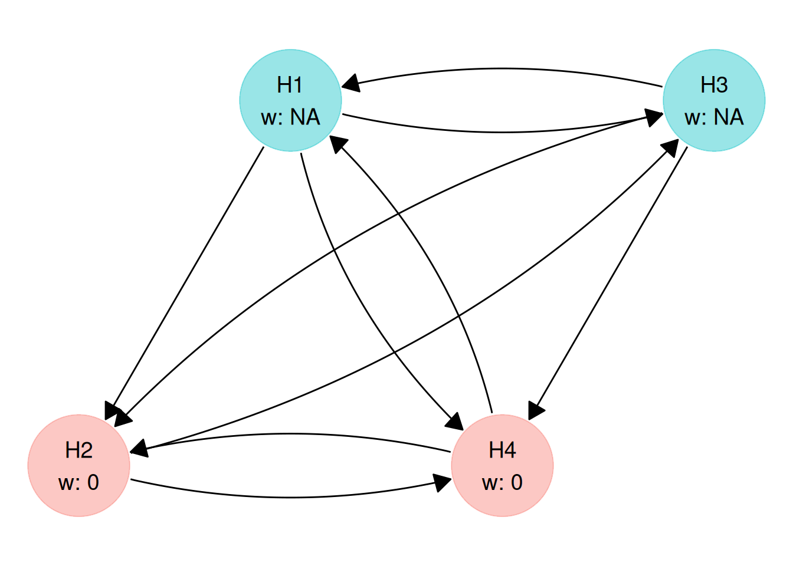
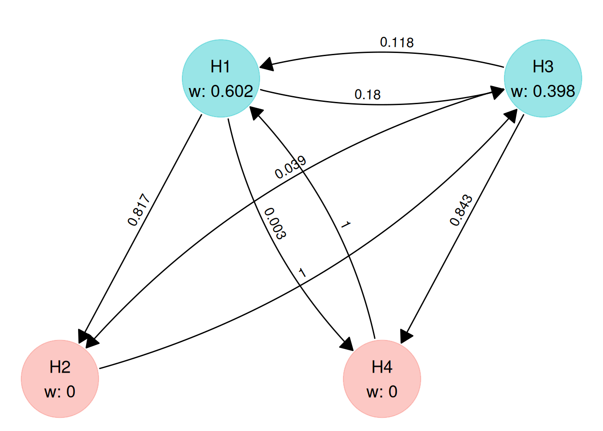
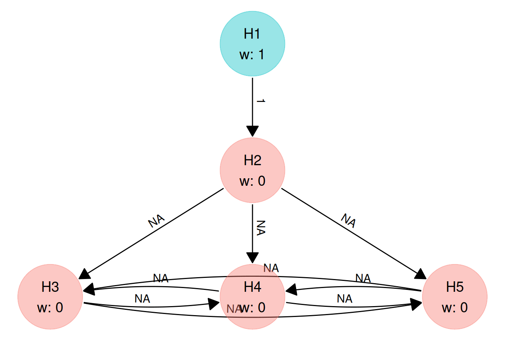
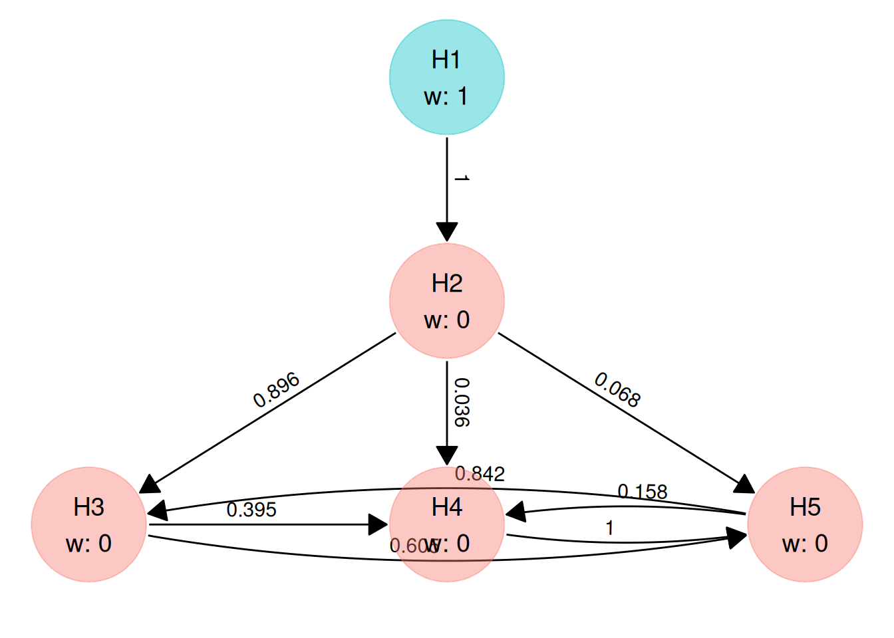

# Trial success functions

## Overview

When a graphical multiple testing procedure $(\mathbf{w},\mathbf{G})$ is
applied to the $p$-values from a clinical trial with $m$ null hypotheses
$H_{1},\ldots,H_{m}$, it produces a binary **rejection pattern**

$$\mathbf{r} = (r_{1},\ldots,r_{m}) \in \{ 0,1\}^{m},$$

where $r_{i} = 1$ if $H_{i}$ is rejected and $r_{i} = 0$ otherwise.
Because every valid graph $(\mathbf{w},\mathbf{G})$ controls the
familywise error rate strongly at level $\alpha$, the choice between
candidate graphs can be based on the clinical, regulatory, and
commercial value of the claims they make.

A **trial success function**
$\left. \psi:\{ 0,1\}^{m}\rightarrow\mathbb{R}_{\geq 0} \right.$ assigns
a non-negative numerical score to each of the $2^{m}$ possible rejection
patterns. In [Spiers et al. (2026)](https://arxiv.org/abs/2609.19994),
$\psi(\mathbf{r})$ is referred to as a **gain function**, and its
expected value under an assumed joint distribution of test statistics
$\mathbf{\theta} = (\mathbf{\Delta},\mathbf{\Sigma})$ is called the
**expected gain**:

$$\mathbb{E}\left\lbrack \psi(\mathbf{r}) \right\rbrack = \sum\limits_{\mathbf{r} \in \{ 0,1\}^{m}}\psi(\mathbf{r}){\Pr}_{\mathbf{\theta}}(\mathbf{R} = \mathbf{r}).$$

Given a matrix of simulated $p$-values `pvals` with $N$ rows (simulated
trials) and $m$ columns (hypotheses), `multigrain` estimates
$\mathbb{E}\lbrack\psi(\mathbf{r})\rbrack$ by evaluating the graphical
testing procedure on every row of `pvals` to obtain an $N \times m$
logical rejection matrix and averaging $\psi(\mathbf{r})$ across the $N$
rows.
[`graph_optimise()`](https://gsk-biostatistics.github.io/multigrain/dev/reference/graph_optimisation.md)
searches over the graphs permitted by a
[`graph_constraint()`](https://gsk-biostatistics.github.io/multigrain/dev/reference/graph_constraint.md)
object to find the parameter values $(\mathbf{w},\mathbf{G})$ that
maximise this expected value.

Two properties follow from the definition of
$\mathbb{E}\lbrack\psi(\mathbf{r})\rbrack$:

1.  **Separation of value and probability:** The probability
    ${\Pr}_{\mathbf{\theta}}(\mathbf{R} = \mathbf{r})$ of each rejection
    pattern is determined by the simulated $p$-values and the graph. The
    trial success function should therefore specify only how valuable
    each outcome $\mathbf{r}$ would be if it occurred. Reducing the
    weight assigned to a hypothesis in $\psi(\mathbf{r})$ because that
    hypothesis has low nominal power penalises its low probability
    twice.
2.  **Scale invariance:** Multiplying $\psi(\mathbf{r})$ by a positive
    constant rescales $\mathbb{E}\lbrack\psi(\mathbf{r})\rbrack$ by the
    same constant without changing which graph maximises it. The trial
    success function does not need to lie in $\lbrack 0,1\rbrack$,
    though scaling $\psi(\mathbf{r})$ so that
    ${\max}_{\mathbf{r}}\psi(\mathbf{r}) = 1$ allows the expected gain
    to be read as a proportion of the value of rejecting all hypotheses.

## Creating a trial success function

The function
[`trial_success()`](https://gsk-biostatistics.github.io/multigrain/dev/reference/trial_success.md)
takes an algebraic/logical expression in the rejection indicators `r1`,
`r2`, …, `rm` and compiles it to C++ via `Rcpp` so that it can be
evaluated rapidly during numerical optimisation. The number of
hypotheses $m$ is inferred from the largest index referenced in the
expression.

### Standard power criteria

Standard multiple-testing power summaries are special cases of trial
success functions:

| Criterion                     | $\psi(\mathbf{r})$                           | [`trial_success()`](https://gsk-biostatistics.github.io/multigrain/dev/reference/trial_success.md) expression ($m = 4$) |
|-------------------------------|----------------------------------------------|-------------------------------------------------------------------------------------------------------------------------|
| Disjunctive power             | $\mathbb{I}\{\sum_{i = 1}^{m}r_{i} \geq 1\}$ | `r1 || r2 || r3 || r4`                                                                                                  |
| Conjunctive power             | $\mathbb{I}\{\sum_{i = 1}^{m}r_{i} = m\}$    | `r1 && r2 && r3 && r4`                                                                                                  |
| Expected number of rejections | $\sum_{i = 1}^{m}r_{i}$                      | `r1 + r2 + r3 + r4`                                                                                                     |
| Average power                 | $\frac{1}{m}\sum_{i = 1}^{m}r_{i}$           | `0.25 * (r1 + r2 + r3 + r4)`                                                                                            |
| Weighted power                | $\sum_{i = 1}^{m}v_{i}r_{i}$                 | `0.4 * r1 + 0.3 * r2 + 0.2 * r3 + 0.1 * r4`                                                                             |

``` r
disjunctive    <- trial_success(r1 || r2 || r3 || r4)
conjunctive    <- trial_success(r1 && r2 && r3 && r4)
exp_rejections <- trial_success(r1 + r2 + r3 + r4)
average        <- trial_success(0.25 * (r1 + r2 + r3 + r4))
weighted       <- trial_success(0.4 * r1 + 0.3 * r2 + 0.2 * r3 + 0.1 * r4)
```

[`calc_power_pvals()`](https://gsk-biostatistics.github.io/multigrain/dev/reference/calc_power_pvals.md)
reports marginal (local) power, disjunctive power, conjunctive power,
and the expected number of rejections for any graph automatically, so
you only need to construct these with
[`trial_success()`](https://gsk-biostatistics.github.io/multigrain/dev/reference/trial_success.md)
when passing them as the objective to
[`graph_optimise()`](https://gsk-biostatistics.github.io/multigrain/dev/reference/graph_optimisation.md).

### Inspecting and evaluating a `multigrain_trial_success` object

A `multigrain_trial_success` object stores the compiled function in
`$func`, the number of hypotheses in `$m`, and the deparsed expression
string in `$objective`:

``` r
average
#> <multigrain_trial_success>
#> 0.25 * (r1 + r2 + r3 + r4)
average$m
#> [1] 4
```

`$func` takes a logical matrix of rejection indicators with $m$ columns
and returns the mean of $\psi(\mathbf{r})$ across its rows:

``` r
set.seed(1)
rej <- matrix(runif(4000) < 0.6, ncol = 4) # 1000 simulated trials, m = 4

exp_rejections$func(rej)
#> [1] 2.445
average$func(rej)
#> [1] 0.61125
disjunctive$func(rej)
#> [1] 0.978
conjunctive$func(rej)
#> [1] 0.145
```

Notice that `exp_rejections$func(rej)` returns approximately `2.4`
rather than `0.6`: it computes the expected *number* of rejections
across the four hypotheses ($4 \times 0.6$), whereas `average$func(rej)`
divides by $m = 4$ to return average power.

Because `$func` accepts any $N \times m$ logical matrix, you can also
pass a single-row matrix (or iterate over rows of
[`expand.grid()`](https://rdrr.io/r/base/expand.grid.html)) to verify
the value of $\psi(\mathbf{r})$ on specific rejection patterns before
running an optimisation:

``` r
# Evaluate weighted power when H1 and H3 are rejected (r = c(1, 0, 1, 0))
weighted$func(matrix(c(TRUE, FALSE, TRUE, FALSE), nrow = 1))
#> [1] 0.6
```

### Expression syntax and type rules

An expression passed to
[`trial_success()`](https://gsk-biostatistics.github.io/multigrain/dev/reference/trial_success.md)
can contain the following elements:

| Element                               | Meaning                                             | Result type          |
|---------------------------------------|-----------------------------------------------------|----------------------|
| `r1`, `r2`, …, `rm`                   | Rejection indicators for $H_{1},H_{2},\ldots,H_{m}$ | Boolean              |
| `&&` (or `and`), `||` (or `or`)       | Logical AND and OR between boolean terms            | Boolean              |
| `*` between two boolean terms         | Product of boolean terms (equivalent to `&&`)       | Boolean              |
| `+`, `-`, `*`, `/` with numeric terms | Standard arithmetic operations                      | Numeric              |
| Numeric literals                      | Constants (e.g. `0.5`, `2`)                         | Numeric              |
| `( )`                                 | Grouping                                            | Preserves inner type |

Two parsing rules are important when writing compound expressions:

1.  **Parenthesise around `&&` and `||`:** Internally,
    [`trial_success()`](https://gsk-biostatistics.github.io/multigrain/dev/reference/trial_success.md)
    replaces `&&` and `||` with custom infix operators (`%AND%` and
    `%OR%`) before parsing the R expression into an abstract syntax
    tree. In R, custom `%...%` operators have equal precedence and are
    evaluated from left to right, unlike standard `&&` and `||` where
    `&&` binds more tightly than `||`. Always place explicit parentheses
    around `&&` and `||` sub-expressions, writing
    `(r1 && r2) || (r3 && r4)` rather than `r1 && r2 || r3 && r4`.
2.  **Boolean versus numeric terms:** The logical operators `&&` and
    `||` are translated to `A * B` and `std::min(1.0, A + B)` in C++.
    Because `std::min(1.0, A + B)` only represents logical OR when `A`
    and `B` take values in $\{ 0,1\}$,
    [`trial_success()`](https://gsk-biostatistics.github.io/multigrain/dev/reference/trial_success.md)
    tracks whether each sub-expression is boolean (`{0, 1}`) or numeric,
    and requires both operands of `&&` and `||` to be boolean.

These rules govern how common patterns are written:

``` r
# Secondary hypotheses H2 and H3 count only if primary H1 is rejected:
# combine the boolean r1 with the numeric bracket using *
gated <- trial_success(r1 * (0.6 + 0.2 * r2 + 0.2 * r3))

# H1 rejected and H2 not rejected: (1 - r2) is numeric, so combine with *
h1_not_h2 <- trial_success(r1 * (1 - r2))

# At least two of three hypotheses rejected: list the pairs explicitly
two_of_three <- trial_success((r1 && r2) || (r1 && r3) || (r2 && r3))
```

Passing a numeric sub-expression to `||` or `&&`, or using comparison
operators such as `>=`, produces an error at compilation time:

``` r
# (r1 + r2) is numeric, so it cannot be an operand of ||
trial_success((r1 + r2) || r3)
#> Error:
#> ! `||` (OR) only allowed between booleans.
```

``` r
# Comparison operators are not supported; write out the logical condition instead
trial_success(r1 + r2 >= 1)
#> Error in `validate_expr_symbols()`:
#> ! Unsupported operator or function `>=` in the trial success expression.
#> ℹ Only arithmetic (`+`, `-`, `*`, `/`), logical (`&&`, `||`), and parentheses
#>   are allowed.
```

### Injecting values from R with `!!`

Because
[`trial_success()`](https://gsk-biostatistics.github.io/multigrain/dev/reference/trial_success.md)
captures its `objective` argument as an unevaluated expression, any
symbol other than `r1, r2, ...` is rejected unless it is unquoted using
`rlang`’s injection operator `!!`:

``` r
v_primary <- 0.6
trial_success(r1 * (!!v_primary + 0.4 * r2))
#> <multigrain_trial_success>
#> r1 * (0.6 + 0.4 * r2)
```

When an expression involves several computed weights, you can also
construct the complete expression as a character string (for example
with [`sprintf()`](https://rdrr.io/r/base/sprintf.html)) and inject the
string with `!!`:

``` r
expr_str <- sprintf("r1 * (%.2f + %.2f * r2)", v_primary, 1 - v_primary)
trial_success(!!expr_str)
#> <multigrain_trial_success>
#> r1 * (0.60 + 0.40 * r2)
```

## Step-functions for regulatory success

Standard power criteria such as average or weighted power assign credit
to each rejected hypothesis regardless of which other hypotheses are
rejected. In confirmatory trials, however, regulatory approval typically
depends on clearing a specific combination of primary or co-primary
hypotheses.

When the sole objective of the multiplicity procedure is to maximise the
probability of achieving regulatory approval (or a specific composite
milestone), the trial success function is a binary **step-function**

$$\psi(\mathbf{r}) = \mathbb{I}_{\text{reg}}(\mathbf{r}) \in \{ 0,1\},$$

which equals `1` if the rejection pattern $\mathbf{r}$ satisfies the
regulatory success condition and `0` otherwise. For any binary
step-function, the expected gain
$\mathbb{E}\lbrack\psi(\mathbf{r})\rbrack = {\Pr}_{\mathbf{\theta}}(\mathbb{I}_{\text{reg}}(\mathbf{R}) = 1)$
is the probability of achieving regulatory success.

Common regulatory success conditions and their
[`trial_success()`](https://gsk-biostatistics.github.io/multigrain/dev/reference/trial_success.md)
expressions are shown below:

| Regulatory requirement                                       | $\mathbb{I}_{\text{reg}}(\mathbf{r})$           | [`trial_success()`](https://gsk-biostatistics.github.io/multigrain/dev/reference/trial_success.md) expression |
|--------------------------------------------------------------|-------------------------------------------------|---------------------------------------------------------------------------------------------------------------|
| Single primary endpoint ($H_{1}$)                            | $r_{1}$                                         | `r1`                                                                                                          |
| Two co-primary endpoints ($H_{1}$ and $H_{2}$ both required) | $r_{1}r_{2}$                                    | `r1 && r2`                                                                                                    |
| Two primary endpoints (either $H_{1}$ or $H_{2}$ sufficient) | $\mathbb{I}\{ r_{1} + r_{2} \geq 1\}$           | `r1 || r2`                                                                                                    |
| Co-primary endpoints met for at least one of two doses       | $\mathbb{I}\{ r_{1}r_{2} + r_{3}r_{4} \geq 1\}$ | `(r1 && r2) || (r3 && r4)`                                                                                    |

### Worked example: co-primary endpoints across two doses (FIBRONEER-ILD)

This example reproduces Example 2 of [Spiers et
al. (2026)](https://arxiv.org/abs/2609.19994), which is motivated by the
FIBRONEER-ILD trial of nerandomilast in patients with progressive
pulmonary fibrosis (Maher et al., 2025). Patients are randomised equally
($1:1:1$) to a high dose, a low dose, or placebo. Each active dose is
compared with placebo on two endpoints: change in forced vital capacity
(FVC, a continuous endpoint) and a binary composite clinical outcome
(time to first acute exacerbation, respiratory hospitalisation, or
death). This yields $m = 4$ hypotheses:

| Hypothesis | Dose comparison       | Endpoint  | Standardised effect $\delta_{i}$ |
|------------|-----------------------|-----------|---------------------------------:|
| $H_{1}$    | High dose vs. placebo | FVC       |                            0.250 |
| $H_{2}$    | High dose vs. placebo | Composite |                            0.150 |
| $H_{3}$    | Low dose vs. placebo  | FVC       |                            0.230 |
| $H_{4}$    | Low dose vs. placebo  | Composite |                            0.145 |

#### Defining the step-function for trial success

Suppose that regulatory approval for a given dose requires statistically
significant results on *both* FVC and the composite endpoint for that
dose, and that the sponsor intends to market a single dose strength.
Succeeding on at least one dose is therefore both necessary and
sufficient for trial success, giving the binary step-function

$$\psi(\mathbf{r}) = \mathbb{I}\{ r_{1}r_{2} + r_{3}r_{4} \geq 1\}.$$

We define this trial success function in `multigrain` using
`(r1 && r2) || (r3 && r4)` and verify its values across all $2^{4} = 16$
rejection patterns:

``` r
win <- trial_success((r1 && r2) || (r3 && r4))
win
#> <multigrain_trial_success>
#> (r1 && r2) || (r3 && r4)

patterns <- as.matrix(expand.grid(
    r1 = c(FALSE, TRUE),
    r2 = c(FALSE, TRUE),
    r3 = c(FALSE, TRUE),
    r4 = c(FALSE, TRUE)
))
pattern_df <- as.data.frame(1L * patterns)
pattern_df$psi <- apply(
    patterns, 1,
    function(row) win$func(matrix(row, nrow = 1))
)
knitr::kable(pattern_df)
```

|  r1 |  r2 |  r3 |  r4 | psi |
|----:|----:|----:|----:|----:|
|   0 |   0 |   0 |   0 |   0 |
|   1 |   0 |   0 |   0 |   0 |
|   0 |   1 |   0 |   0 |   0 |
|   1 |   1 |   0 |   0 |   1 |
|   0 |   0 |   1 |   0 |   0 |
|   1 |   0 |   1 |   0 |   0 |
|   0 |   1 |   1 |   0 |   0 |
|   1 |   1 |   1 |   0 |   1 |
|   0 |   0 |   0 |   1 |   0 |
|   1 |   0 |   0 |   1 |   0 |
|   0 |   1 |   0 |   1 |   0 |
|   1 |   1 |   0 |   1 |   1 |
|   0 |   0 |   1 |   1 |   1 |
|   1 |   0 |   1 |   1 |   1 |
|   0 |   1 |   1 |   1 |   1 |
|   1 |   1 |   1 |   1 |   1 |

#### Statistical assumptions and graph constraints

With $n = 360$ patients per arm ($1080$ patients in total) and one-sided
$\alpha = 0.025$, the non-centrality parameter for hypothesis $H_{i}$ is
$\Delta_{i} = \delta_{i}\sqrt{n}$. The correlation between test
statistics is assumed to be $0.4$ between the two endpoints within the
same dose, $0.5$ between the two doses on the same endpoint, and $0.2$
between different endpoints across different doses:

``` r
alpha <- 0.025
n_per_arm <- 360
delta <- c(0.250, 0.150, 0.230, 0.145)
ncp_dose <- delta * sqrt(n_per_arm)

corr_dose <- matrix(
    c(
        1.0, 0.4, 0.5, 0.2,
        0.4, 1.0, 0.2, 0.5,
        0.5, 0.2, 1.0, 0.4,
        0.2, 0.5, 0.4, 1.0
    ),
    nrow = 4,
    byrow = TRUE
)

# Convert non-centrality parameters to nominal per-hypothesis power
power_dose <- pnorm(ncp_dose - qnorm(1 - alpha))
round(power_dose, 3)
#> [1] 0.997 0.812 0.992 0.786
```

The graph constraints reflect the endpoint hierarchy within each dose:
all initial $\alpha$ is allocated to the two FVC hypotheses
($w_{2} = w_{4} = 0$), and neither composite hypothesis is permitted to
pass $\alpha$ directly back to the FVC hypothesis of its own dose
($g_{21} = g_{43} = 0$). All remaining weights and transition entries
are left free (`NA`) to be optimised:

``` r
gc_dose <- graph_constraint(
    hyp_constraint = c(NA, 0, NA, 0),
    trans_constraint = matrix(
        c(
            0,  NA, NA, NA,
            0,  0,  NA, NA,
            NA, NA, 0,  NA,
            NA, NA, 0,  0
        ),
        nrow = 4,
        byrow = TRUE
    )
)

plot(gc_dose)
```



#### Optimising the graph

We simulate $10^{6}$ trials with
[`simulate_pvalues()`](https://gsk-biostatistics.github.io/multigrain/dev/reference/simulate_pvalues.md)
and pass `win` and `gc_dose` to
[`graph_optimise()`](https://gsk-biostatistics.github.io/multigrain/dev/reference/graph_optimisation.md):

``` r
set.seed(2026)
pvals_dose <- simulate_pvalues(
    power_nominal = power_dose,
    alpha = alpha,
    corr_matrix = corr_dose,
    nsim = 1e6
)

ctrl <- multigrain_control() |>
    control_nsim_global(1e5) |>
    control_global(run = 1000)

graph_dose <- graph_optimise(
    pvals = pvals_dose,
    graph_constraint = gc_dose,
    trial_success = win,
    alpha = alpha,
    control = ctrl,
    num_threads = 4
)
```

``` r
graph_dose
#> <multigrain_graph_optimal>
#> Optimal graph found (given user-defined constraints on graph and computational resources):
#> 
#> Hypothesis weights:
#>     H1     H2     H3     H4 
#> 0.6024 0.0000 0.3976 0.0000 
#> 
#> Transition matrix:
#>       H1     H2     H3     H4
#> H1 0.000 0.8172 0.1799 0.0029
#> H2 0.000 0.0000 1.0000 0.0000
#> H3 0.118 0.0391 0.0000 0.8429
#> H4 1.000 0.0000 0.0000 0.0000
#> 
#> Trial success function:
#> (r1 && r2) || (r3 && r4)
#> 
#> Value of trial success measure:
#> 0.85
plot(graph_dose, digits = 3)
```



The optimised graph splits the initial $\alpha$ between the two FVC
hypotheses ($w_{1} \approx 0.57$ on the high dose and
$w_{3} \approx 0.43$ on the low dose) and routes the transition weights
around a single cycle:
$\left. H_{1}\rightarrow H_{2}\rightarrow H_{3}\rightarrow H_{4}\rightarrow H_{1} \right.$.
Under this structure, rejecting the FVC hypothesis for a dose passes all
of its $\alpha$ to the composite endpoint for that same dose (directly
targeting the pair $r_{1}r_{2}$ or $r_{3}r_{4}$ needed for the
step-function to reach `1`), and once both endpoints for one dose are
rejected, the entire $\alpha$ transfers to the FVC hypothesis of the
other dose.

#### Comparing against conventional procedures

Because
[`graph_optimise()`](https://gsk-biostatistics.github.io/multigrain/dev/reference/graph_optimisation.md)
selects the weights that maximise
$\mathbb{E}\lbrack\psi(\mathbf{r})\rbrack$ on `pvals_dose`, evaluating
the optimised graph on the same simulated matrix is subject to selection
optimism. To compare candidate procedures without bias, we generate an
independent matrix `pvals_dose_new` of $10^{6}$ simulated trials and
evaluate the optimised graph alongside a fixed-sequence procedure
($\left. H_{1}\rightarrow H_{2}\rightarrow H_{3}\rightarrow H_{4} \right.$)
and a Bonferroni-Holm procedure using
[`calc_power_pvals()`](https://gsk-biostatistics.github.io/multigrain/dev/reference/calc_power_pvals.md):

``` r
set.seed(20261)
pvals_dose_new <- simulate_pvalues(
    power_nominal = power_dose,
    alpha = alpha,
    corr_matrix = corr_dose,
    nsim = 1e6
)

# Fixed sequence: H1 -> H2 -> H3 -> H4
w_seq4 <- c(1, 0, 0, 0)
G_seq4 <- matrix(
    c(
        0, 1, 0, 0,
        0, 0, 1, 0,
        0, 0, 0, 1,
        0, 0, 0, 0
    ),
    nrow = 4,
    byrow = TRUE
)

# Bonferroni-Holm on 4 hypotheses
w_holm4 <- rep(1 / 4, 4)
G_holm4 <- matrix(1 / 3, nrow = 4, ncol = 4)
diag(G_holm4) <- 0

res_dose_opt <- calc_power_pvals(
    pvals_dose_new,
    hyp_weight = graph_dose$hyp_weight,
    trans_matrix = graph_dose$trans_matrix,
    alpha = alpha,
    custom_power = list(gain = win)
)

res_dose_seq <- calc_power_pvals(
    pvals_dose_new,
    hyp_weight = w_seq4,
    trans_matrix = G_seq4,
    alpha = alpha,
    custom_power = list(gain = win),
    sum_to_one_constraint = FALSE
)

res_dose_holm <- calc_power_pvals(
    pvals_dose_new,
    hyp_weight = w_holm4,
    trans_matrix = G_holm4,
    alpha = alpha,
    custom_power = list(gain = win)
)

dose_comparison <- data.frame(
    Procedure = c(
        "Optimised graph",
        "Fixed sequence (H1 -> H2 -> H3 -> H4)",
        "Bonferroni-Holm"
    ),
    `Expected gain` = c(
        res_dose_opt$gain,
        res_dose_seq$gain,
        res_dose_holm$gain
    ),
    rbind(
        res_dose_opt$local_power,
        res_dose_seq$local_power,
        res_dose_holm$local_power
    ),
    check.names = FALSE
)
names(dose_comparison)[3:6] <- c("H1", "H2", "H3", "H4")

knitr::kable(dose_comparison, digits = 3, row.names = FALSE)
```

| Procedure                                | Expected gain |    H1 |    H2 |    H3 |    H4 |
|:-----------------------------------------|--------------:|------:|------:|------:|------:|
| Optimised graph                          |         0.850 | 0.996 | 0.778 | 0.988 | 0.744 |
| Fixed sequence (H1 -\> H2 -\> H3 -\> H4) |         0.811 | 0.997 | 0.811 | 0.806 | 0.682 |
| Bonferroni-Holm                          |         0.848 | 0.992 | 0.773 | 0.982 | 0.749 |

In the fixed-sequence procedure, failure to reject the high-dose
composite hypothesis $H_{2}$ (which has lower nominal power than the FVC
endpoints) prevents the low dose ($H_{3},H_{4}$) from being tested at
all, reducing the probability of succeeding on at least one dose from
$0.851$ to $0.818$.

## Hurdle formulation with relative values for secondaries

In many confirmatory trials, clearing the primary regulatory requirement
is necessary for drug approval, while rejecting key secondary hypotheses
supports additional efficacy claims in the product label. A secondary
rejection has no practical value if the primary regulatory hurdle is not
met, because the treatment is not approved.

[Spiers et al. (2026)](https://arxiv.org/abs/2609.19994) represent this
hierarchy using a **hurdle formulation** that multiplies the regulatory
step-function $\mathbb{I}_{\text{reg}}(\mathbf{r})$ by a base value for
regulatory approval plus incremental values for the secondary
hypotheses:

$$\psi(\mathbf{r}) = \mathbb{I}_{\text{reg}}(\mathbf{r})\left( v_{\text{base}} + \sum\limits_{j \in \mathcal{S}}v_{j}r_{j} \right),$$

where:

- $\mathbb{I}_{\text{reg}}(\mathbf{r}) \in \{ 0,1\}$ indicates whether
  the regulatory requirement for approval is met;
- $v_{\text{base}} \geq 0$ is the baseline value of achieving regulatory
  approval alone;
- $\mathcal{S} \subseteq \{ 1,\ldots,m\}$ is the index set of secondary
  hypotheses not included in $\mathbb{I}_{\text{reg}}(\mathbf{r})$;
- $v_{j} \geq 0$ is the incremental value of the label claim supported
  by rejecting $H_{j}$ ($j \in \mathcal{S}$), conditional on regulatory
  approval.

For example, when $H_{1}$ and $H_{2}$ are co-primary hypotheses and
$H_{3}$ and $H_{4}$ are secondary hypotheses with
$v_{\text{base}} = 0.6$ and $v_{3} = v_{4} = 0.2$, the hurdle function
is written as:

``` r
hurdle_example <- trial_success((r1 && r2) * (0.6 + 0.2 * r3 + 0.2 * r4))
```

The additive sum $\sum_{j \in \mathcal{S}}v_{j}r_{j}$ assumes that each
secondary claim contributes the same incremental value regardless of
which other secondary hypotheses are rejected. If two secondary
endpoints measure closely related clinical constructs so that the second
rejection adds less value once the first has been secured, diminishing
returns can be written directly using `||` and `&&`:

``` r
# Rejecting either H2 or H3 adds 0.25; rejecting both adds a further 0.15
diminishing <- trial_success(r1 * (0.6 + 0.25 * (r2 || r3) + 0.15 * (r2 && r3)))
```

### When the baseline approval value $v_{\text{base}}$ affects the optimal graph

Taking expectations of the hurdle formulation splits the expected gain
into two terms:

$$\mathbb{E}\left\lbrack \psi(\mathbf{r}) \right\rbrack = v_{\text{base}}{\Pr}_{\mathbf{\theta}}\left( \mathbb{I}_{\text{reg}}(\mathbf{R}) = 1 \right) + \sum\limits_{j \in \mathcal{S}}v_{j}{\Pr}_{\mathbf{\theta}}\left( \mathbb{I}_{\text{reg}}(\mathbf{R}) = 1{\mspace{6mu}\text{and}\mspace{6mu}}R_{j} = 1 \right).$$

Suppose the graph constraints allocate all initial $\alpha$ to the
primary hypotheses and prevent secondary hypotheses from being tested
until the regulatory requirement
$\mathbb{I}_{\text{reg}}(\mathbf{r}) = 1$ has been met (for example, a
single primary hypothesis with $w_{1} = 1$, or two co-primary hypotheses
tested in a fixed sequence with $w_{1} = 1,g_{12} = 1$). Then the event
$\{\mathbb{I}_{\text{reg}}(\mathbf{R}) = 1\}$ depends only on the
primary $p$-values and has the exact same probability
${\Pr}_{\mathbf{\theta}}(\mathbb{I}_{\text{reg}}(\mathbf{R}) = 1)$ under
every candidate graph permitted by the constraints. Consequently, the
first term
$v_{\text{base}}{\Pr}_{\mathbf{\theta}}(\mathbb{I}_{\text{reg}}(\mathbf{R}) = 1)$
is a constant across the entire search space, and the optimal graph
depends only on the relative secondary weights $v_{j}$
($j \in \mathcal{S}$).

By contrast, $v_{\text{base}}$ actively influences the optimal graph
whenever candidate graphs can trade off the probability of regulatory
approval against the probability of secondary claims, such as when:

- there are multiple routes to regulatory approval (for example, two
  doses or a full population and a biomarker subpopulation) that share
  initial $\alpha$; or
- secondary hypotheses receive non-zero initial $\alpha$ or receive
  recycled $\alpha$ before all components of
  $\mathbb{I}_{\text{reg}}(\mathbf{r})$ have been rejected.

### Setting relative values from team scores

When specifying $v_{\text{base}}$ and $v_{j}$ ($j \in \mathcal{S}$) with
a clinical, regulatory, and commercial trial team, [Spiers et
al. (2026)](https://arxiv.org/abs/2609.19994) describe a structured
scoring procedure that normalises
${\max}_{\mathbf{r}}\psi(\mathbf{r}) = 1$:

1.  **Score the secondary claims relative to one another:** Conditional
    on the trial achieving regulatory approval
    ($\mathbb{I}_{\text{reg}}(\mathbf{r}) = 1$), assign each secondary
    hypothesis $H_{j}$ ($j \in \mathcal{S}$) a relative value score
    ${\bar{s}}_{j}$ on a $0$ to $100$ scale, where $100$ represents the
    single most valuable secondary claim.
2.  **Anchor the total secondary value relative to regulatory
    approval:** If achieving regulatory approval alone has a score of
    $100$, let $S_{\text{all}} \geq 100$ denote the score of achieving
    regulatory approval together with *all* secondary claims in
    $\mathcal{S}$. The ratio
    $$\kappa = \frac{S_{\text{all}} - 100}{100}$$ is the combined value
    of all secondary claims expressed as a multiple of the value of
    regulatory approval alone.
3.  **Convert to normalised weights:** Setting
    $$v_{\text{base}} = \frac{1}{1 + \kappa},\qquad v_{j} = \frac{\kappa}{1 + \kappa} \cdot \frac{{\bar{s}}_{j}}{\sum\limits_{\ell \in \mathcal{S}}{\bar{s}}_{\ell}}\quad(j \in \mathcal{S})$$
    satisfies $v_{\text{base}} + \sum_{j \in \mathcal{S}}v_{j} = 1$, so
    that complete success across all hypotheses has value $1$ and
    regulatory approval alone has value $v_{\text{base}}$.

### Worked example: co-primary and key secondary endpoints (ECZTRA 3)

This example reproduces Example 3 of [Spiers et
al. (2026)](https://arxiv.org/abs/2609.19994), which is based on the
phase III ECZTRA 3 trial of tralokinumab plus topical corticosteroids in
moderate-to-severe atopic dermatitis (Silverberg et al., 2021). The
multiplicity procedure tests two co-primary endpoints ($H_{1},H_{2}$)
and three key secondary endpoints ($H_{3},H_{4},H_{5}$) at one-sided
$\alpha = 0.025$:

| Hypothesis | Endpoint                                              | Role          | Nominal power | $\Delta_{i}$ |
|------------|-------------------------------------------------------|---------------|--------------:|-------------:|
| $H_{1}$    | IGA 0/1 at week 16                                    | Co-primary    |          0.90 |         3.24 |
| $H_{2}$    | EASI-75 at week 16                                    | Co-primary    |          0.90 |         3.24 |
| $H_{3}$    | Worst daily pruritus NRS ($\geq 4$-point improvement) | Key secondary |          0.80 |         2.80 |
| $H_{4}$    | DLQI ($\geq 4$-point improvement)                     | Key secondary |          0.70 |         2.48 |
| $H_{5}$    | SCORAD (change from baseline)                         | Key secondary |          0.85 |         3.00 |

The clinician-assessed severity endpoints (IGA 0/1, EASI-75, and SCORAD)
are assumed to have pairwise correlation $0.8$, while the
patient-reported outcomes (pruritus and DLQI) have correlation $0.5$
with each other and with the clinician-assessed endpoints.

#### Constructing the hurdle trial success function

Regulatory approval requires rejecting both co-primary hypotheses, so
$\mathbb{I}_{\text{reg}}(\mathbf{r}) = r_{1}r_{2}$. For the three
secondary endpoints $\mathcal{S} = \{ 3,4,5\}$, the consensus relative
value scores in Spiers et al. (2026) are ${\bar{s}}_{3} = 85$
(pruritus), ${\bar{s}}_{4} = 50$ (DLQI), and ${\bar{s}}_{5} = 15$
(SCORAD), with anchor score $S_{\text{all}} = 180$ (achieving all three
secondary claims adds $\kappa = 0.80$, or $80\%$, to the value of
regulatory approval alone):

``` r
scores <- c(H3 = 85, H4 = 50, H5 = 15)
s_all <- 180

kappa <- (s_all - 100) / 100
v_base <- 1 / (1 + kappa)
v <- kappa / (1 + kappa) * scores / sum(scores)

round(c(base = v_base, v), 3)
#>  base    H3    H4    H5 
#> 0.556 0.252 0.148 0.044
```

We format the hurdle expression as a string using
[`sprintf()`](https://rdrr.io/r/base/sprintf.html) and pass it to
[`trial_success()`](https://gsk-biostatistics.github.io/multigrain/dev/reference/trial_success.md)
via `!!`:

``` r
psi_ecztra <- sprintf(
    "r1 * r2 * (%.3f + %.3f * r3 + %.3f * r4 + %.3f * r5)",
    v_base, v[["H3"]], v[["H4"]], v[["H5"]]
)
psi_ecztra
#> [1] "r1 * r2 * (0.556 + 0.252 * r3 + 0.148 * r4 + 0.044 * r5)"

gain_ecztra <- trial_success(!!psi_ecztra)
gain_ecztra
#> <multigrain_trial_success>
#> r1 * r2 * (0.556 + 0.252 * r3 + 0.148 * r4 + 0.044 * r5)
```

Under `gain_ecztra`, any trial that fails to reject either $H_{1}$ or
$H_{2}$ receives a score of `0`, rejecting $H_{1}$ and $H_{2}$ alone
receives `0.556`, and rejecting all five hypotheses receives `1.000`.

#### Statistical assumptions and graph constraints

``` r
power_ecztra <- c(0.90, 0.90, 0.80, 0.70, 0.85)

corr_ecztra <- matrix(
    c(
        1.0, 0.8, 0.5, 0.5, 0.8,
        0.8, 1.0, 0.5, 0.5, 0.8,
        0.5, 0.5, 1.0, 0.5, 0.5,
        0.5, 0.5, 0.5, 1.0, 0.5,
        0.8, 0.8, 0.5, 0.5, 1.0
    ),
    nrow = 5,
    byrow = TRUE
)
```

Because both $H_{1}$ and $H_{2}$ must be rejected at level $\alpha$
before any secondary hypothesis can be claimed, testing $H_{1}$ at full
$\alpha$ ($w_{1} = 1$) and passing its entire weight to $H_{2}$
($g_{12} = 1$) rejects $\{ H_{1},H_{2}\}$ whenever
${\max}(p_{1},p_{2}) < \alpha$. Once $H_{2}$ is rejected, its $\alpha$
is distributed across the secondary hypotheses $H_{3},H_{4},H_{5}$,
which may recycle $\alpha$ among themselves but not back to $H_{1}$ or
$H_{2}$:

``` r
gc_ecztra <- graph_constraint(
    hyp_constraint = c(1, 0, 0, 0, 0),
    trans_constraint = matrix(
        c(
            0, 1, 0,  0,  0,
            0, 0, NA, NA, NA,
            0, 0, 0,  NA, NA,
            0, 0, NA, 0,  NA,
            0, 0, NA, NA, 0
        ),
        nrow = 5,
        byrow = TRUE
    )
)

plot(gc_ecztra)
```



Because $w_{1} = 1$ and $g_{12} = 1$ are fixed by `gc_ecztra`, every
permitted graph has the same probability of rejecting both co-primary
hypotheses, and the optimiser chooses the nine free transition weights
among $H_{2},H_{3},H_{4},H_{5}$ to maximise the expected secondary
contribution.

#### Optimising the graph

``` r
set.seed(2027)
pvals_ecztra <- simulate_pvalues(
    power_nominal = power_ecztra,
    alpha = alpha,
    corr_matrix = corr_ecztra,
    nsim = 1e6
)

graph_ecztra <- graph_optimise(
    pvals = pvals_ecztra,
    graph_constraint = gc_ecztra,
    trial_success = gain_ecztra,
    alpha = alpha,
    control = ctrl,
    num_threads = 4
)
```

``` r
graph_ecztra
#> <multigrain_graph_optimal>
#> Optimal graph found (given user-defined constraints on graph and computational resources):
#> 
#> Hypothesis weights:
#> H1 H2 H3 H4 H5 
#>  1  0  0  0  0 
#> 
#> Transition matrix:
#>    H1 H2     H3     H4     H5
#> H1  0  1 0.0000 0.0000 0.0000
#> H2  0  0 0.8958 0.0358 0.0684
#> H3  0  0 0.0000 0.3947 0.6053
#> H4  0  0 0.0000 0.0000 1.0000
#> H5  0  0 0.8425 0.1575 0.0000
#> 
#> Trial success function:
#> r1 * r2 * (0.556 + 0.252 * r3 + 0.148 * r4 + 0.044 * r5)
#> 
#> Value of trial success measure:
#> 0.7742
plot(graph_ecztra, digits = 3)
```



In this design, the secondary hypotheses differ in the order of their
relative values ($v_{3} = 0.252 > v_{4} = 0.148 > v_{5} = 0.044$) and
the order of their nominal powers
($\pi_{5} = 0.85 > \pi_{3} = 0.80 > \pi_{4} = 0.70$). Moreover, SCORAD
($H_{5}$) is strongly correlated ($0.8$) with the co-primary endpoints
$H_{1}$ and $H_{2}$, so conditional on $H_{1}$ and $H_{2}$ being
rejected, $p_{5}$ tends to be small. The optimised graph balances these
factors by sending most of $H_{2}$’s recycled weight to pruritus
($H_{3}$, the highest-value secondary claim) while allocating the
remainder across SCORAD ($H_{5}$) and DLQI ($H_{4}$).

#### Comparing against conventional procedures

We compare the optimised graph on an independent matrix of $10^{6}$
simulated trials against three standard secondary testing strategies
that share the same co-primary gate
($\left. H_{1}\rightarrow H_{2} \right.$):

- **Value-ordered fixed sequence:** tests the secondary hypotheses in
  decreasing order of clinical value
  ($\left. H_{3}\rightarrow H_{4}\rightarrow H_{5} \right.$);
- **Power-ordered fixed sequence:** tests the secondary hypotheses in
  decreasing order of nominal power
  ($\left. H_{5}\rightarrow H_{3}\rightarrow H_{4} \right.$);
- **Bonferroni-Holm on secondaries:** splits $H_{2}$’s weight equally
  ($1/3$ each) across $H_{3},H_{4},H_{5}$ with equal recycling ($1/2$)
  among them.

``` r
set.seed(20271)
pvals_ecztra_new <- simulate_pvalues(
    power_nominal = power_ecztra,
    alpha = alpha,
    corr_matrix = corr_ecztra,
    nsim = 1e6
)

w_ecztra <- c(1, 0, 0, 0, 0)

# Value-ordered fixed sequence: H1 -> H2 -> H3 -> H4 -> H5
G_val_seq <- matrix(
    c(
        0, 1, 0, 0, 0,
        0, 0, 1, 0, 0,
        0, 0, 0, 1, 0,
        0, 0, 0, 0, 1,
        0, 0, 0, 0, 0
    ),
    nrow = 5,
    byrow = TRUE
)

# Power-ordered fixed sequence: H1 -> H2 -> H5 -> H3 -> H4
G_pow_seq <- matrix(
    c(
        0, 1, 0, 0, 0,
        0, 0, 0, 0, 1,
        0, 0, 0, 1, 0,
        0, 0, 0, 0, 0,
        0, 0, 1, 0, 0
    ),
    nrow = 5,
    byrow = TRUE
)

# Bonferroni-Holm on H3, H4, H5 after H1 -> H2
G_holm_sec <- matrix(
    c(
        0, 1, 0,     0,     0,
        0, 0, 1 / 3, 1 / 3, 1 / 3,
        0, 0, 0,     1 / 2, 1 / 2,
        0, 0, 1 / 2, 0,     1 / 2,
        0, 0, 1 / 2, 1 / 2, 0
    ),
    nrow = 5,
    byrow = TRUE
)

res_ecz_opt <- calc_power_pvals(
    pvals_ecztra_new,
    hyp_weight = graph_ecztra$hyp_weight,
    trans_matrix = graph_ecztra$trans_matrix,
    alpha = alpha,
    custom_power = list(gain = gain_ecztra)
)

res_ecz_val <- calc_power_pvals(
    pvals_ecztra_new,
    hyp_weight = w_ecztra,
    trans_matrix = G_val_seq,
    alpha = alpha,
    custom_power = list(gain = gain_ecztra),
    sum_to_one_constraint = FALSE
)

res_ecz_pow <- calc_power_pvals(
    pvals_ecztra_new,
    hyp_weight = w_ecztra,
    trans_matrix = G_pow_seq,
    alpha = alpha,
    custom_power = list(gain = gain_ecztra),
    sum_to_one_constraint = FALSE
)

res_ecz_holm <- calc_power_pvals(
    pvals_ecztra_new,
    hyp_weight = w_ecztra,
    trans_matrix = G_holm_sec,
    alpha = alpha,
    custom_power = list(gain = gain_ecztra)
)

ecztra_comparison <- data.frame(
    Procedure = c(
        "Optimised graph",
        "Value-ordered sequence (H3 -> H4 -> H5)",
        "Power-ordered sequence (H5 -> H3 -> H4)",
        "Bonferroni-Holm on H3, H4, H5"
    ),
    `Expected gain` = c(
        res_ecz_opt$gain,
        res_ecz_val$gain,
        res_ecz_pow$gain,
        res_ecz_holm$gain
    ),
    rbind(
        res_ecz_opt$local_power[3:5],
        res_ecz_val$local_power[3:5],
        res_ecz_pow$local_power[3:5],
        res_ecz_holm$local_power[3:5]
    ),
    check.names = FALSE
)
names(ecztra_comparison)[3:5] <- c("H3", "H4", "H5")

knitr::kable(ecztra_comparison, digits = 3, row.names = FALSE)
```

| Procedure                                 | Expected gain |    H3 |    H4 |    H5 |
|:------------------------------------------|--------------:|------:|------:|------:|
| Optimised graph                           |         0.775 | 0.719 | 0.579 | 0.719 |
| Value-ordered sequence (H3 -\> H4 -\> H5) |         0.770 | 0.726 | 0.580 | 0.558 |
| Power-ordered sequence (H5 -\> H3 -\> H4) |         0.768 | 0.689 | 0.558 | 0.799 |
| Bonferroni-Holm on H3, H4, H5             |         0.770 | 0.679 | 0.608 | 0.750 |

The optimised graph achieves the highest expected gain ($0.774$),
retaining nearly the same local power on the high-value pruritus
endpoint ($H_{3}$) as the value-ordered sequence while substantially
increasing power on SCORAD ($H_{5}$) and DLQI ($H_{4}$) when an earlier
secondary hypothesis fails to reject.

## References

Bretz, F., Maurer, W., Brannath, W., and Posch, M. (2009). A graphical
approach to sequentially rejective multiple test procedures. *Statistics
in Medicine*, 28(4), 586–604. <https://doi.org/10.1002/sim.3495>

Maher, T. M., et al. (2025). Nerandomilast in patients with progressive
pulmonary fibrosis. *New England Journal of Medicine*, 392(22),
2203–2214. <https://doi.org/10.1056/NEJMoa2503643>

Silverberg, J. I., et al. (2021). Tralokinumab plus topical
corticosteroids for the treatment of moderate-to-severe atopic
dermatitis: results from the double-blind, randomized, multicentre,
placebo-controlled phase III ECZTRA 3 trial. *British Journal of
Dermatology*, 184(3), 450–463.

Spiers, A. D. V., Grayling, M. J., Wheeler, G. M., and Mander, A. P.
(2026). Gain-function optimisation of graphical multiple testing
procedures for confirmatory clinical trials. *arXiv:2609.19994*.
<https://arxiv.org/abs/2609.19994>
